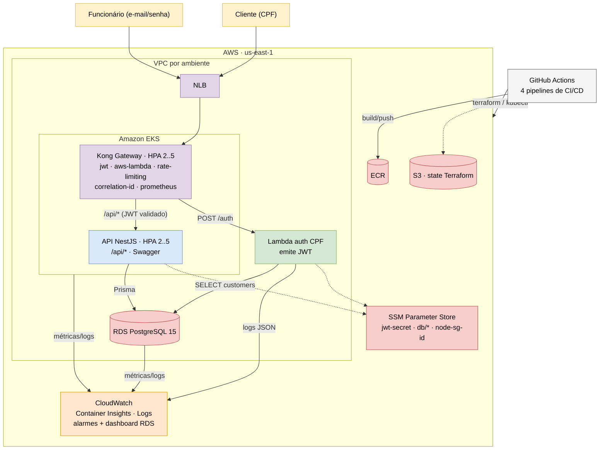
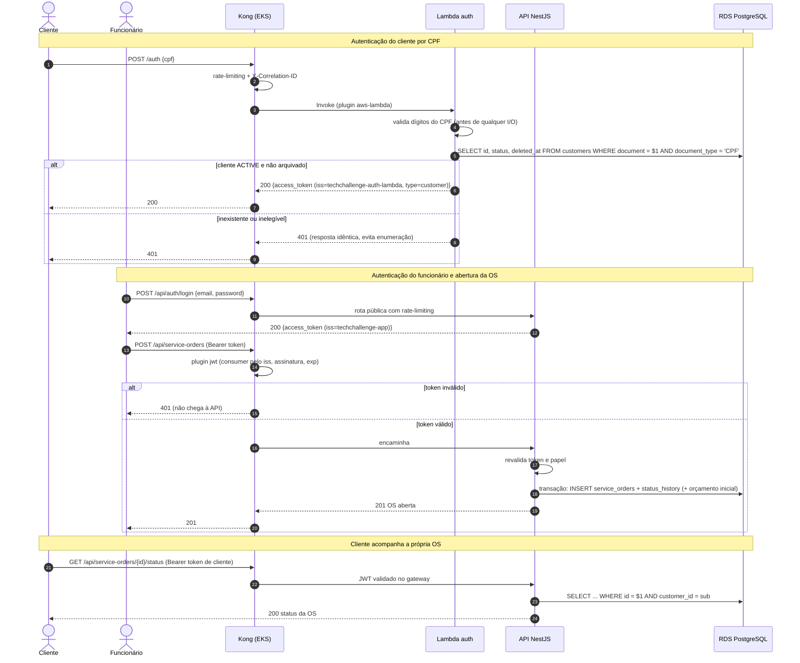
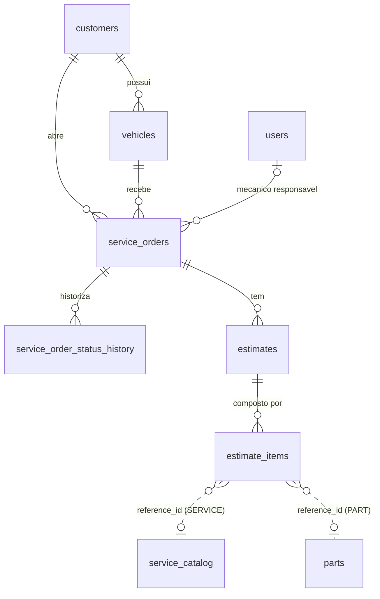

# Tech Challenge — Fase 3 · Documentação Geral da Arquitetura

Documentação arquitetural do sistema de **gestão de oficina mecânica** desenvolvido no
Tech Challenge da Pós-Tech FIAP. Este repositório reúne a visão geral da
solução — diagramas, RFCs, ADRs e a justificativa do banco de dados — e aponta para os
quatro repositórios de implementação, cada um com código, Dockerfile, pipelines de CI/CD e README.

## Sumário

- [Visão geral da solução](#visão-geral-da-solução)
- [Repositórios](#repositórios)
- [Diagrama de componentes](#diagrama-de-componentes)
- [Diagramas de sequência](#diagramas-de-sequência)
- [RFCs](#rfcs)
- [ADRs](#adrs)
- [Banco de dados: justificativa e modelo relacional](#banco-de-dados-justificativa-e-modelo-relacional)
- [CI/CD e ambientes](#cicd-e-ambientes)
- [Ordem de deploy](#ordem-de-deploy)
- [APIs: Swagger, deploys ativos](#apis-swagger-e-deploys-ativos)
- [Estrutura deste repositório](#estrutura-deste-repositório)

---

## Visão geral da solução

A oficina centraliza cadastro de clientes e veículos, abertura e acompanhamento de
**ordens de serviço (OS)**, catálogo de serviços, peças e estoque, orçamentos e métricas
operacionais. Na Fase 3 a solução foi levada para a **AWS** com:

| Requisito da Fase 3 | Implementação |
|---|---|
| API Gateway (controle e roteamento) | **Kong** Ingress Controller DB-less no EKS, atrás de um NLB ([ADR-003](docs/adrs/ADR-003-kong-como-api-gateway.md)) |
| Function Serverless de autenticação por CPF | **AWS Lambda** (container image, Node 22) que valida o CPF, consulta existência e status do cliente e emite JWT ([RFC-003](docs/rfcs/RFC-003-estrategia-de-autenticacao.md)) |
| Banco de dados gerenciado | **Amazon RDS for PostgreSQL 15** ([RFC-002](docs/rfcs/RFC-002-escolha-do-banco-de-dados.md)) |
| Cluster Kubernetes com escalabilidade | **Amazon EKS** + **HPA** na aplicação e no Kong ([ADR-002](docs/adrs/ADR-002-hpa-e-escalabilidade-no-eks.md)) |
| Infraestrutura como código | **Terraform**, um state por repositório e ambiente ([ADR-004](docs/adrs/ADR-004-iac-terraform-multi-repositorio.md)) |
| CI/CD | **GitHub Actions** em todos os repositórios: `develop` → staging, `main` → produção |
| Monitoramento | **CloudWatch** (Container Insights, Logs, alarmes e dashboard do RDS), métricas **Prometheus** do Kong, forwarder opcional para Datadog/New Relic |

---

## Repositórios

| # | Repositório | Responsabilidade | Dockerfile | CI/CD |
|---|---|---|---|---|
| 1 | [TechChallange---Function-Serverless](https://github.com/DevKaue/TechChallange---Function-Serverless) | Function Serverless (Lambda) de autenticação por CPF | ✅ imagem da Lambda | `ci.yml` (lint, testes, contratos, Terraform, imagem) · `deploy.yml` (ECR + Terraform + smoke pelo Kong) |
| 2 | [TechChallenge---Infraestrutura-Kubernetes-com-Terraform](https://github.com/thiagoalmeida88/TechChallenge---Infraestrutura-Kubernetes-com-Terraform) | VPC, EKS, addons, ALB Controller, **Kong**, ECR, segredo JWT, OIDC | — (só IaC) | `ci.yml` (fmt + validate) · `deploy.yml` (plan → aprovação → apply) · `destroy.yml` |
| 3 | [tech-challenge-database-infra](https://github.com/DevKaue/tech-challenge-database-infra) | RDS PostgreSQL, contrato de conexão no SSM, alarmes | — (só IaC) | `ci.yml` (fmt, validate, `terraform test`, Trivy) · `deploy.yml` (plan → guarda → apply → confere SSM) · `destroy.yml` |
| 4 | [tech-challenge-app-](https://github.com/DevKaue/tech-challenge-app-) | Aplicação principal (NestJS) em Kubernetes, rotas e plugins do Kong | ✅ imagem da API | `ci.yml` (lint, unit, integração, Docker, manifestos) · `deploy.yml` (ECR + `kubectl apply -k` + rollback + smoke) |
| — | **tech-challenge-docs** (este) | Documentação arquitetural transversal | — | — |

---

## Diagrama de componentes

Visão de **nuvem, APIs, banco e monitoramento**. Versão comentada, com tabela de
responsabilidades e observabilidade, em
[docs/arquitetura/diagrama-de-componentes.md](docs/arquitetura/diagrama-de-componentes.md).



---

## Diagramas de sequência

Fluxos de **autenticação** (cliente por CPF e funcionário por e-mail/senha) e **abertura
de ordem de serviço**, incluindo os caminhos de erro (400, 401, 403/404, 503). Os três
diagramas completos estão em
[docs/arquitetura/diagramas-de-sequencia.md](docs/arquitetura/diagramas-de-sequencia.md).



---

## RFCs

Propostas técnicas com alternativas comparadas e decisão resultante.

| RFC | Título | Status |
|---|---|---|
| [RFC-001](docs/rfcs/RFC-001-escolha-da-nuvem.md) | Escolha do provedor de nuvem — AWS (`us-east-1`) | Aceita |
| [RFC-002](docs/rfcs/RFC-002-escolha-do-banco-de-dados.md) | Escolha do banco de dados gerenciado — RDS PostgreSQL | Aceita |
| [RFC-003](docs/rfcs/RFC-003-estrategia-de-autenticacao.md) | Estratégia de autenticação — Lambda emite, Kong valida, aplicação revalida | Aceita |

RFCs específicas de cada repositório:
[Function — RFC-001 autenticação por CPF com JWT](https://github.com/DevKaue/TechChallange---Function-Serverless/blob/main/docs/RFCs/RFC-001-autenticacao-por-cpf-com-jwt.md) ·
[Database — RFC-001 escolha do banco gerenciado](https://github.com/DevKaue/tech-challenge-database-infra/blob/main/docs/RFCs/RFC-001-escolha-do-banco-gerenciado.md) ·
[App — RFC-001 estratégia de autenticação](https://github.com/DevKaue/tech-challenge-app-/blob/main/docs/RFCs/RFC-001-estrategia-de-autenticacao.md)

---

## ADRs

Decisões arquiteturais permanentes que valem para a solução inteira.

| ADR | Decisão | Status |
|---|---|---|
| [ADR-001](docs/adrs/ADR-001-padrao-de-comunicacao.md) | Padrão de comunicação: HTTP/REST síncrono com entrada única pelo API Gateway; integração entre repositórios via SSM e tags | Aceito |
| [ADR-002](docs/adrs/ADR-002-hpa-e-escalabilidade-no-eks.md) | Escalabilidade horizontal com HPA (CPU 70%, 2..5 réplicas), PDB e metrics-server | Aceito |
| [ADR-003](docs/adrs/ADR-003-kong-como-api-gateway.md) | Kong Ingress Controller DB-less como API Gateway | Aceito |
| [ADR-004](docs/adrs/ADR-004-iac-terraform-multi-repositorio.md) | Terraform com um repositório e um state S3 por componente e ambiente | Aceito |

ADRs específicas de cada repositório:

| Repositório | ADRs |
|---|---|
| App | [ADR-001 monólito modular](https://github.com/DevKaue/tech-challenge-app-/blob/main/docs/ADRs/ADR-001-monolito-modular-bounded-contexts.md) · [ADR-002 Clean Architecture + DDD tático](https://github.com/DevKaue/tech-challenge-app-/blob/main/docs/ADRs/ADR-002-clean-architecture-ddd-tatico-por-modulo.md) · [ADR-003 Node.js + TypeScript + Nest](https://github.com/DevKaue/tech-challenge-app-/blob/main/docs/ADRs/ADR-003-nodejs-typescript-nest.md) · [ADR-004 PostgreSQL](https://github.com/DevKaue/tech-challenge-app-/blob/main/docs/ADRs/ADR-004-postgresql-como-banco-principal.md) · [ADR-005 Kong](https://github.com/DevKaue/tech-challenge-app-/blob/main/docs/ADRs/ADR-005-kong-como-api-gateway.md) |
| Function | [ADR-001 composição no primeiro request](https://github.com/DevKaue/TechChallange---Function-Serverless/blob/main/docs/ADRs/ADR-001-composicao-no-primeiro-request-e-authorizer-sem-banco.md) · [ADR-002 Kong invoca a função sem API Gateway](https://github.com/DevKaue/TechChallange---Function-Serverless/blob/main/docs/ADRs/ADR-002-kong-invoca-a-funcao-sem-api-gateway.md) |
| Database | [ADR-001 RDS PostgreSQL](https://github.com/DevKaue/tech-challenge-database-infra/blob/main/docs/ADRs/ADR-001-rds-postgresql-gerenciado.md) · [ADR-002 contrato via SSM](https://github.com/DevKaue/tech-challenge-database-infra/blob/main/docs/ADRs/ADR-002-contrato-via-ssm-parameter-store.md) · [ADR-003 um state por ambiente](https://github.com/DevKaue/tech-challenge-database-infra/blob/main/docs/ADRs/ADR-003-um-state-por-ambiente.md) |

---

## Banco de dados: justificativa e modelo relacional

Documento completo: **[docs/banco-de-dados/modelo-relacional.md](docs/banco-de-dados/modelo-relacional.md)**
— justificativa formal, ajustes no modelo, diagrama ER e explicação de cada relacionamento.

**Por que RDS PostgreSQL 15** ([RFC-002](docs/rfcs/RFC-002-escolha-do-banco-de-dados.md)):

- domínio fortemente relacional (cliente → veículo → OS → orçamento → itens + histórico),
  com integridade referencial e transações ACID no banco;
- compatível sem retrabalho com as migrations do Prisma (enums nativos, índice único
  parcial), com paridade entre local, CI e nuvem;
- gerenciado (backup, patch, monitoramento), privado, cifrado e com TLS obrigatório;
- custo dentro do Free Tier / AWS Academy (`db.t4g.micro`).

**Ajuste no modelo relacional na Fase 3:** coluna `customers.status`
(`ACTIVE | INACTIVE | BLOCKED`, `NOT NULL DEFAULT 'ACTIVE'`), consultada pela Lambda junto
com `deleted_at` para decidir se o cliente pode se autenticar.



| Relacionamento | Cardinalidade | Regra | Motivo |
|---|---|---|---|
| cliente → veículos | 1:N | `RESTRICT` | Veículo sempre tem dono; arquivamento é lógico (`deleted_at`) |
| cliente → OS | 1:N | `RESTRICT` | Registra quem trouxe o veículo naquela data; OS é documento |
| veículo → OS | 1:N | `RESTRICT` | Histórico de manutenção não some em cascata |
| mecânico → OS | 0..1:N | `SET NULL` | OS nasce sem mecânico; remover funcionário não apaga OS |
| OS → histórico de status | 1:N | `CASCADE` | Composição; base do tempo médio por status |
| OS → orçamentos | 1:N | `RESTRICT` | Orçamento aprovado é registro de acordo com o cliente |
| orçamento → itens | 1:N | `CASCADE` | Composição; item guarda snapshot de descrição e preço |

---

## CI/CD e ambientes

| Branch | Ambiente | Comportamento |
|---|---|---|
| `feature/*` → PR | — | `ci.yml` obrigatório para merge |
| `develop` | **staging** (homologação) | Deploy automático desligado por padrão (`STAGING_ENABLED=true` nos repositórios de infraestrutura) |
| `main` | **prod** | Deploy automático com **aprovação manual** no environment `production` |

Regras comuns: `main` protegida, sem push direto, merge somente via Pull Request com CI
verde; credenciais AWS por OIDC (`AWS_DEPLOY_ROLE`) ou, no AWS Academy, pelos secrets
temporários `AWS_LAB_*`.

## Ordem de deploy

```text
0. Infra K8s · bootstrap/   → bucket S3 do state (uma vez por conta)
1. Infra K8s                → VPC, EKS, Kong, ECR, segredo JWT e SG dos nós no SSM
2. Database                 → RDS na VPC (descoberta por tag), contrato em /techchallenge/<env>/db/*
3. Function Serverless      → Lambda nas subnets privadas, lê JWT e banco do SSM
4. App                      → imagem no ECR, migrations Prisma, kubectl apply (API + rotas Kong)
```

Teardown na ordem inversa (`kubectl delete -k` da App **antes** de destruir a Infra K8s).

---

## APIs: Swagger e deploys ativos

Toda a API pública é exposta pelo **Kong**, no hostname do NLB do Service
`kong-gateway-proxy` (namespace `kong`).

> **Deploy ativo:** o ambiente AWS (AWS Academy Learner Lab) **não está de pé no momento**,
> por isso não há URL pública fixa. A URL é gerada a cada provisionamento e é obtida com:
>
> ```bash
> kubectl -n kong get svc kong-gateway-proxy -o jsonpath='{.status.loadBalancer.ingress[0].hostname}'
> ```
>
> Com o ambiente de pé, substitua `<KONG_URL>` abaixo por esse hostname.

| API | Documentação | Endereço (via Kong) | Local |
|---|---|---|---|
| Aplicação (NestJS) | Swagger gerado pelo `@nestjs/swagger` | `http://<KONG_URL>/api/docs` | `http://localhost:3000/api/docs` |
| Autenticação por CPF (Lambda) | [OpenAPI `openapi.yaml`](https://github.com/DevKaue/TechChallange---Function-Serverless/blob/main/docs/api/openapi.yaml) · [Coleção Postman](https://github.com/DevKaue/TechChallange---Function-Serverless/blob/main/docs/postman/techchallenge-auth.postman_collection.json) | `POST http://<KONG_URL>/auth` | Runtime Interface Emulator `:9000` |
| Health check | — | `GET http://<KONG_URL>/api/health` | `GET http://localhost:3000/api/health` |

---

## Estrutura deste repositório

```text
.
├── README.md                               # este índice
└── docs/
    ├── arquitetura/
    │   ├── diagrama-de-componentes.md      # nuvem, APIs, banco e monitoramento
    │   └── diagramas-de-sequencia.md       # autenticação e abertura de OS
    ├── rfcs/
    │   ├── RFC-001-escolha-da-nuvem.md
    │   ├── RFC-002-escolha-do-banco-de-dados.md
    │   └── RFC-003-estrategia-de-autenticacao.md
    ├── adrs/
    │   ├── ADR-001-padrao-de-comunicacao.md
    │   ├── ADR-002-hpa-e-escalabilidade-no-eks.md
    │   ├── ADR-003-kong-como-api-gateway.md
    │   └── ADR-004-iac-terraform-multi-repositorio.md
    └── banco-de-dados/
        └── modelo-relacional.md            # justificativa, ajustes, ER e relacionamentos
```