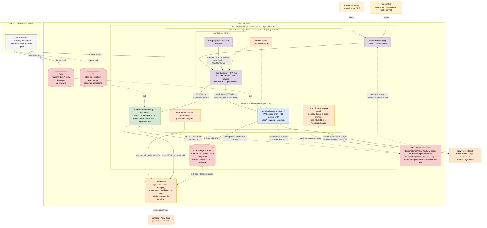

# Diagrama de Componentes

Visão completa da solução da Fase 3: **nuvem (AWS)**, **APIs** (Kong, aplicação e Function
Serverless), **banco de dados** (RDS PostgreSQL) e **monitoramento** (New Relic, CloudWatch,
Container Insights e métricas Prometheus do Kong). Cada caixa indica o repositório que a provisiona.

## Visão geral

## Componentes e responsabilidades

| Componente | Tecnologia | Responsabilidade | Repositório |
|---|---|---|---|
| Rede | VPC 3 AZ, NAT único, subnets públicas/privadas com tags de descoberta | Isolar os ambientes `staging` e `prod`; subnets privadas para EKS, Lambda e RDS | [Infra K8s](https://github.com/thiagoalmeida88/TechChallenge---Infraestrutura-Kubernetes-com-Terraform) |
| Cluster | Amazon EKS 1.35, managed node group (2..4 nós) | Executar a aplicação e o gateway | Infra K8s |
| API Gateway | Kong Ingress Controller 3.9 (chart `kong/ingress` 0.24.0), DB-less, atrás de um NLB | Roteamento, validação de JWT, rate limit, correlation-id, métricas por rota e invocação da Lambda | Infra K8s (instalação) + App (rotas e plugins) |
| Aplicação | NestJS + Prisma em container, Kustomize | Domínio da oficina: clientes, veículos, catálogo, peças, OS, orçamentos, métricas | [App](https://github.com/DevKaue/tech-challenge-app-) |
| Function Serverless | AWS Lambda (container image, Node 22) | Autenticar o cliente por CPF e emitir JWT | [Function](https://github.com/DevKaue/TechChallange---Function-Serverless) |
| Banco de dados | Amazon RDS PostgreSQL 15 | Persistência transacional de todos os contextos | [Database](https://github.com/DevKaue/tech-challenge-database-infra) |
| Configuração e segredos | SSM Parameter Store (`String` / `SecureString`) | Contrato entre os repositórios: segredo JWT, endpoint/credenciais do banco, SG dos nós | Infra K8s + Database |
| Registro de imagens | Amazon ECR | Imagens versionadas da API e da Lambda | Infra K8s (API) + Function (Lambda) |
| State do IaC | S3 com versionamento e `use_lockfile` | State Terraform isolado por repositório e ambiente | Infra K8s (`bootstrap/`) |
| Monitoramento | New Relic (`nri-bundle` no cluster, agente APM na API, dashboards, alertas e Synthetics), CloudWatch (Container Insights, Logs, alarmes, dashboard), plugin `prometheus` do Kong | Saúde do cluster, traces e logs da API com correlation-id, volume e tempo por status das OS, uptime, saúde do banco | Infra K8s (`nri-bundle`) + App (agente e logs) + Todos |
| CI/CD | GitHub Actions | Testes, build de imagem, `terraform plan/apply` com gate de aprovação em produção, `kubectl apply` com rollback | Todos |

## Observabilidade ponta a ponta

| Camada | O que é coletado | Onde ver |
|---|---|---|
| Gateway (Kong) | Latência, status HTTP e banda por rota/serviço (plugin `prometheus`); `X-Correlation-ID` gerado em toda requisição | Endpoint `/metrics` do Kong (scrape por Prometheus/Datadog/New Relic) |
| Aplicação (EKS) | CPU/memória por pod e nó, reinícios, logs `stdout` dos containers | CloudWatch Container Insights |
| Escalabilidade | Uso de CPU vs. request para o HPA da API e do Kong | `kubectl get hpa -A` (metrics-server) |
| Function Serverless | Uma linha JSON por evento (`auth.success`, `auth.denied`, `db.error`...) com `correlationId`; `Invocations`, `Duration`, `Throttles` | CloudWatch Logs `/aws/lambda/techchallenge-auth-<env>` + métricas da Lambda |
| Aplicação (New Relic) | Agente APM Node (`-r newrelic`) e logs JSON com `correlationId`, `trace.id` e eventos `http.request`, `http.error`, `service_order.created` e `service_order.status_changed` | New Relic: APM e Distributed tracing, Logs e dashboards por NRQL |
| Cluster (New Relic) | `nri-bundle` (infraestrutura, kube-state-metrics, eventos do Kubernetes e logs) | New Relic: Kubernetes explorer, CPU e memória por pod, réplicas do HPA |
| Uptime (New Relic) | Monitor Synthetics `techchallenge-health` (ping em `/api/health`) e alerta de falha | New Relic: Synthetic monitoring |
| Banco (RDS) | Alarmes de CPU, memória livre, conexões e latência de escrita; queries > 1 s; `pg_stat_statements` | CloudWatch alarmes + dashboard `techchallenge-<env>-database` |

O `X-Correlation-ID` gerado pelo Kong viaja até a Lambda e a aplicação, então um mesmo ID
liga o log do gateway, o log da função e o log da API. No New Relic, o mesmo
`correlationId` filtra os logs da API, e o `trace.id` do log abre o trace da requisição.
