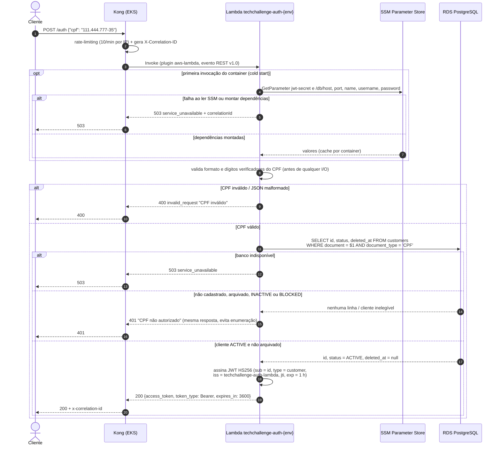
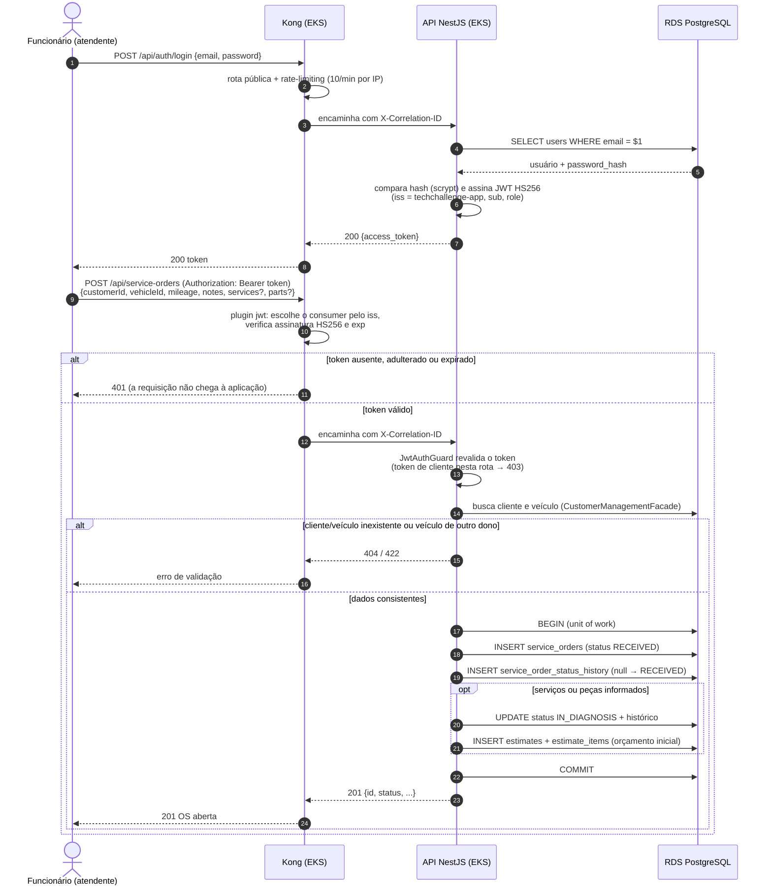
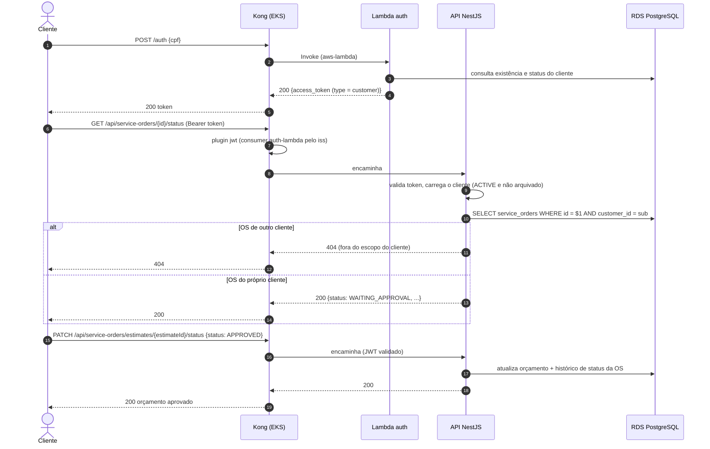

# Diagramas de Sequência

Dois fluxos centrais da Fase 3: **autenticação** (cliente por CPF via Function Serverless e
funcionário por e-mail/senha na aplicação) e **abertura de ordem de serviço**, incluindo o
acompanhamento da OS pelo próprio cliente com o token emitido pela Lambda.

Todo o tráfego externo entra pelo **Kong** (API Gateway). O Kong valida o JWT antes de a
requisição chegar à aplicação, e a aplicação valida de novo (defesa em profundidade) —
decisão registrada na [RFC-003](../rfcs/RFC-003-estrategia-de-autenticacao.md) e no
[ADR-003](../adrs/ADR-003-kong-como-api-gateway.md).

## 1. Autenticação do cliente por CPF

## 2. Autenticação do funcionário e abertura da ordem de serviço

## 3. Fluxo completo: cliente acompanha e aprova a própria OS

Depois que a OS existe, o cliente usa o token emitido pela Lambda para acompanhá-la. As
rotas marcadas com `@CustomerAccess()` aceitam o token `type: customer`, desde que a OS
seja do próprio cliente (`sub` = `service_orders.customer_id`).

> Fontes Mermaid relacionadas nos repositórios:
> [`09-sequencia-autenticacao-os.mmd`](https://github.com/DevKaue/tech-challenge-app-/blob/main/docs/diagrams/09-sequencia-autenticacao-os.mmd) (App) e
> [`02-sequencia-autenticacao.mmd`](https://github.com/DevKaue/TechChallange---Function-Serverless/blob/main/docs/diagrams/02-sequencia-autenticacao.mmd) (Function).
