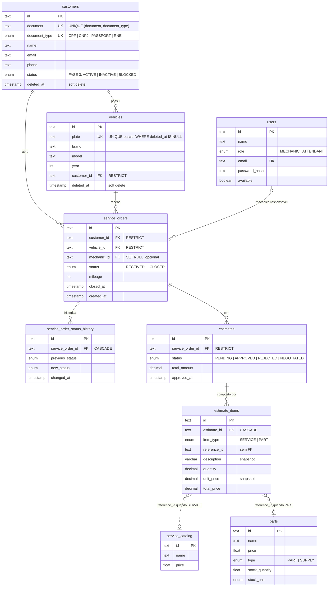

# Banco de Dados: justificativa formal e modelo relacional

Este documento consolida a **justificativa da escolha do banco**, os **ajustes no modelo
relacional** feitos na Fase 3, o **diagrama ER** e a **explicação dos relacionamentos**.

* Decisão formal: [RFC-002](../rfcs/RFC-002-escolha-do-banco-de-dados.md)
* Documento completo (índices, convenções, lacunas):
  [`docs/modelagem-de-dados.md`](https://github.com/DevKaue/tech-challenge-database-infra/blob/main/docs/modelagem-de-dados.md)
  no repositório de banco
* Fonte de verdade do schema: [`prisma/schema.prisma`](https://github.com/DevKaue/tech-challenge-app-/blob/main/prisma/schema.prisma)
  e `prisma/migrations/` no repositório da App

## 1. Justificativa da escolha: Amazon RDS for PostgreSQL 15

| Requisito | Como o RDS PostgreSQL atende |
|---|---|
| **Banco gerenciado** (exigência da Fase 3) | Backup, patch de versão menor, monitoramento e substituição de hardware feitos pela AWS |
| **Domínio relacional** (cliente → veículo → OS → orçamento → itens, com histórico) | Integridade referencial **no banco** (FKs com `RESTRICT`, `CASCADE`, `SET NULL`) e transações ACID na abertura de OS e aprovação de orçamento |
| **Compatibilidade sem retrabalho** com as 13 migrations do Prisma | Enums nativos (`CREATE TYPE ... AS ENUM`) e **índice único parcial** em `vehicles.plate` — recursos do PostgreSQL que MySQL e DynamoDB não oferecem da mesma forma |
| **Paridade dev/prod** | Mesmo PostgreSQL 15 no Docker Compose local, no CI (testes de integração) e no RDS |
| **Leitura rápida pela Lambda** | Consulta por igualdade no índice único `(document, document_type)` |
| **Segurança** | Subnets privadas, sem IP público, storage cifrado (KMS), `rds.force_ssl = 1`, acesso só por security group de origem, senha em SSM `SecureString` |
| **Custo** | `db.t4g.micro` (~US$ 0,47/dia por ambiente), coberto pelo Free Tier / crédito do AWS Academy |
| **Conhecimento do time** | PostgreSQL já usado nas Fases 1 e 2 ([ADR-004 da App](https://github.com/DevKaue/tech-challenge-app-/blob/main/docs/ADRs/ADR-004-postgresql-como-banco-principal.md)) |

Alternativas descartadas (detalhe na RFC-002): **Aurora Serverless v2** (piso de custo ~3×
maior sem necessidade de elasticidade), **PostgreSQL no EKS** (não é gerenciado; dado preso
ao ciclo de vida do cluster) e **DynamoDB** (modelo chave-valor exigiria reescrever a
persistência e mover a integridade para a aplicação).

## 2. Ajustes no modelo relacional (Fase 3)

### 2.1 `customers.status` — elegibilidade do cliente para autenticar

A Function Serverless precisa consultar **existência e status** do cliente. Até a Fase 2 só
havia `deleted_at` (arquivado ou não), que não permite bloquear um cliente sem apagá-lo.

```sql
-- migration 20261009230000_add_status_to_customers (repositório da App)
CREATE TYPE "CustomerStatus" AS ENUM ('ACTIVE', 'INACTIVE', 'BLOCKED');

ALTER TABLE "customers"
  ADD COLUMN "status" "CustomerStatus" NOT NULL DEFAULT 'ACTIVE';
```

| Decisão | Motivo |
|---|---|
| Enum em vez de booleano `is_active` | Distingue `INACTIVE` (deixou de usar) de `BLOCKED` (oficina impediu o acesso) |
| `NOT NULL DEFAULT 'ACTIVE'` | Clientes existentes continuam elegíveis; no PG 11+ o `ADD COLUMN` com default constante não reescreve a tabela |
| Convive com `deleted_at` | Arquivar continua sendo exclusão lógica; `status` descreve o ciclo de vida de quem não foi arquivado |
| Sem índice em `status` | A Lambda localiza pelo índice único do documento e só **lê** o status da linha |

Regra de elegibilidade aplicada pela Lambda **e** revalidada pela aplicação:
`status = 'ACTIVE' AND deleted_at IS NULL`.

### 2.2 Ajustes anteriores consolidados no schema atual

| Migration | Ajuste | Por quê |
|---|---|---|
| `20260624020106_add_deleted_at_to_customers_and_vehicles` | Soft delete em `customers` e `vehicles` | Cliente e veículo são arquivados, não apagados — preserva histórico de OS |
| `20260624022932_alter_vehicle_plate_unique_to_partial_index` | `UNIQUE (plate) WHERE deleted_at IS NULL` | Permite a mesma placa voltar com outro dono após arquivar o registro antigo |
| `20260624000000_materials_include_supplies` | `parts.type` (`PART` / `SUPPLY`) e unidades de estoque | A tabela passou a guardar também insumos |
| `20260602000000_add-users-and-closed-status` / `20260620000000_add_available_to_users` | `users` (atendente/mecânico) e disponibilidade do mecânico | Login de funcionário e atribuição de mecânico à OS |

## 3. Diagrama ER

Linha cheia = chave estrangeira real. Linha tracejada = referência lógica (polimórfica, sem FK).



## 4. Explicação dos relacionamentos

| Relacionamento | Cardinalidade | `ON DELETE` | Justificativa |
|---|---|---|---|
| `customers` → `vehicles` | 1 : N | `RESTRICT` | Todo veículo tem exatamente um dono. O fluxo normal arquiva (`deleted_at`); o `RESTRICT` impede que um `DELETE` manual deixe veículo órfão |
| `customers` → `service_orders` | 1 : N | `RESTRICT` | A OS guarda o cliente **além** do veículo: registra quem trouxe o veículo naquela data, fato que não muda se o veículo trocar de dono. OS é documento operacional/financeiro |
| `vehicles` → `service_orders` | 1 : N | `RESTRICT` | Histórico de manutenção do veículo não pode sumir em cascata |
| `users` → `service_orders` (mecânico) | 0..1 : N | `SET NULL` | A OS nasce na recepção, antes de alguém assumi-la. Remover um funcionário não apaga a OS (CASCADE destruiria histórico) nem é bloqueado (RESTRICT) |
| `service_orders` → `service_order_status_history` | 1 : N | `CASCADE` | Composição: log imutável de transições, sem sentido fora da OS. Base do cálculo de **tempo médio por status** |
| `service_orders` → `estimates` | 1 : N | `RESTRICT` | Uma OS pode ter vários orçamentos na negociação; orçamento aprovado é registro de acordo com o cliente |
| `estimates` → `estimate_items` | 1 : N | `CASCADE` | Composição pura. O item guarda `description` e `unit_price` como **snapshot**: mudar o catálogo não altera orçamento aprovado |
| `estimate_items` → `service_catalog` / `parts` | N : 1 (lógico) | — | Referência polimórfica por `item_type` + `reference_id`; FK do Postgres aponta para uma só tabela. Integridade garantida pelo `UNIQUE (estimate_id, item_type, reference_id)` e pelo snapshot |

## 5. Índices que sustentam os fluxos principais

| Fluxo | Índice |
|---|---|
| Autenticação por CPF (Lambda) | `customers_document_document_type_key` — `UNIQUE (document, document_type)` |
| Login de funcionário | `users_email_key` — `UNIQUE (email)` |
| Placa ativa única | `vehicles_plate_active_unique_idx` — `UNIQUE (plate) WHERE deleted_at IS NULL` |
| Fila de OS por etapa / histórico por cliente e veículo | `idx_service_orders_status`, `_customer_id`, `_vehicle_id`, `_created_at` |
| Tempo médio por status | `idx_status_history_service_order_id`, `idx_status_history_changed_at` |
| Orçamentos pendentes | `idx_estimates_status`, `idx_estimates_service_order_id` |

## 6. Propriedade do schema

| O quê | Dono |
|---|---|
| Instância, rede, parameter group, alarmes, contrato no SSM | [tech-challenge-database-infra](https://github.com/DevKaue/tech-challenge-database-infra) (Terraform) |
| Tabelas, colunas, índices, enums | [tech-challenge-app-](https://github.com/DevKaue/tech-challenge-app-) (migrations Prisma, `prisma migrate deploy` no deploy) |
| Leitura de `customers` | [TechChallange---Function-Serverless](https://github.com/DevKaue/TechChallange---Function-Serverless) (somente `SELECT id, status, deleted_at`) |

O RDS nasce vazio; as tabelas aparecem no primeiro `prisma migrate deploy`. Manter o schema
em um único lugar evita que Terraform e ORM disputem a mesma tabela.
