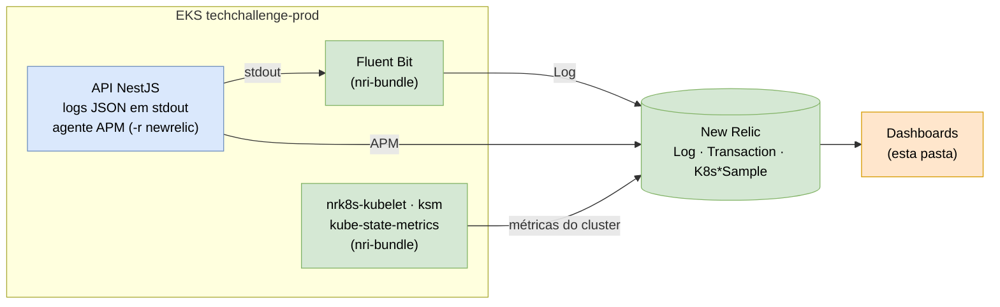
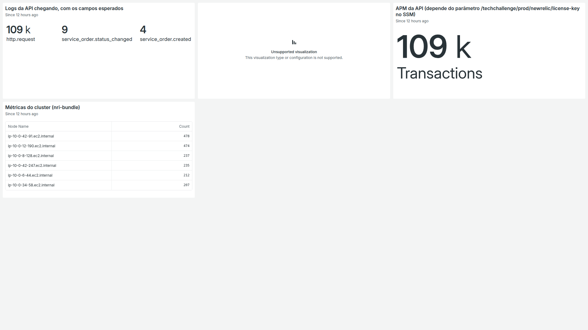
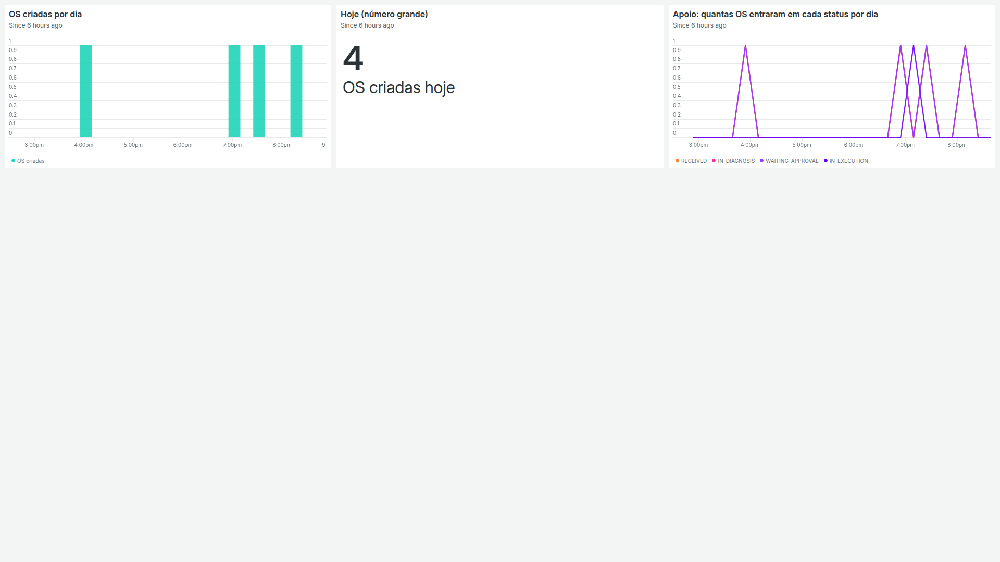
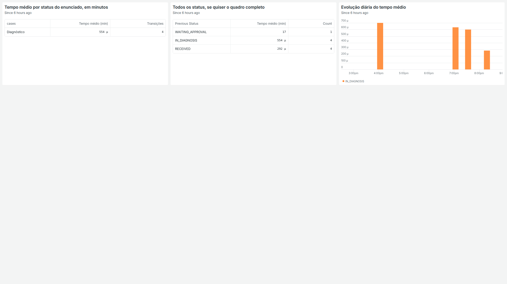
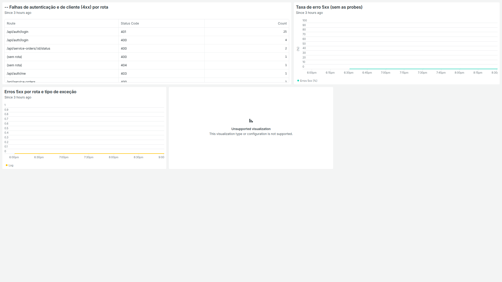
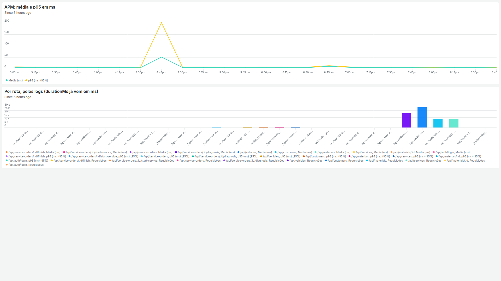
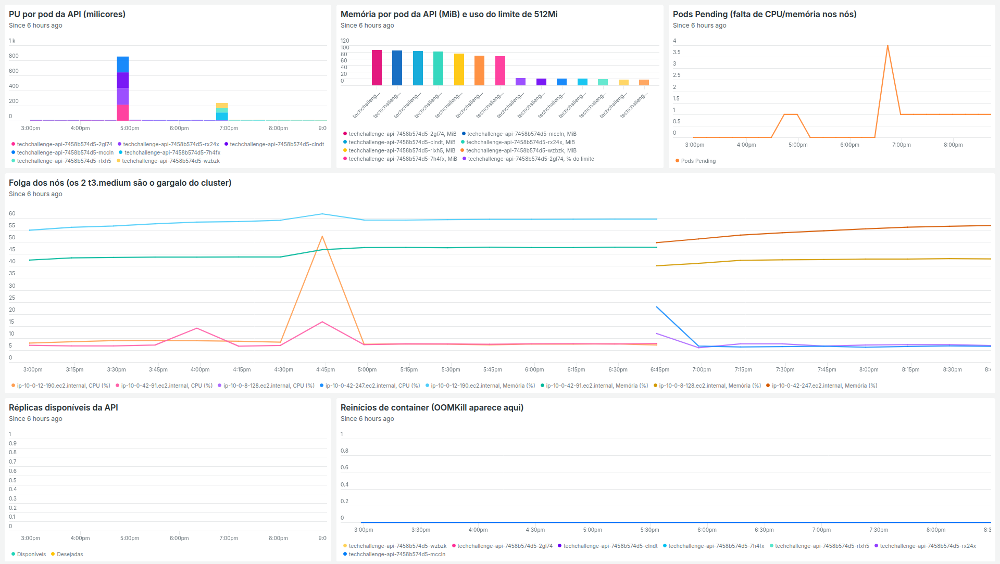
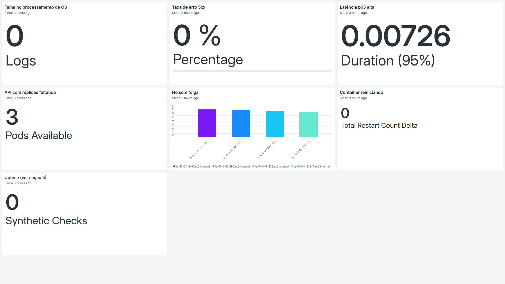

# Dashboards do New Relic

Painéis de observabilidade da Fase 3, montados no New Relic sobre a telemetria do ambiente
de produção (`techchallenge-prod`). Cada dashboard tem dois arquivos nesta pasta:

| Arquivo | Para que serve | Quem usa |
|---|---|---|
| `*.png` | **Evidência**: captura do painel com dados reais, renderizada direto no GitHub | Avaliação e leitura da documentação |
| `*.json` | **Fonte**: export do dashboard (widgets, NRQL, layout), para recriar o painel em qualquer conta | Quem for reimportar ou alterar o painel |

### Por que manter os dois

- **Só o PNG** mostraria o painel, mas não daria para recriá-lo nem revisar as consultas. O
  ambiente roda no AWS Academy e é derrubado entre as sessões; sem o JSON, cada nova conta
  New Relic teria que montar os painéis à mão.
- **Só o JSON** é reproduzível, mas o GitHub não o renderiza, e ele não prova que a
  telemetria chegou. A captura mostra os dados fluindo (logs, APM e métricas do cluster).
- O JSON é a **fonte de verdade**. O PNG é um retrato do momento da captura: quando um
  painel mudar, exporte o JSON de novo e refaça a captura.

> Os widgets do tipo **tabela de logs** (`logger.log-table-widget`) aparecem como
> *Unsupported visualization* nas capturas. É uma limitação da exportação de imagem do
> New Relic, não um erro da consulta: no painel ao vivo eles mostram as linhas de log.

## Requisitos de monitoramento × dashboards

| Requisito | Dashboard | Fonte dos dados |
|---|---|---|
| Volume diário de ordens de serviço | [01 · Volume diário de OS](#01--volume-diário-de-ordens-de-serviço) | Logs da API (`service_order.created`) |
| Tempo médio de execução por status (diagnóstico, execução, finalização) | [02 · Tempo médio por status](#02--tempo-médio-de-execução-por-status) | Logs da API (`service_order.status_changed`) |
| Erros e falhas nas integrações | [03 · Erros e falhas](#03--erros-e-falhas-nas-integrações) | Logs da API (`http.request`, `http.error`) |
| Latência das APIs | [04 · Latência das APIs](#04--latência-das-apis) | APM (`Transaction`) e logs (`durationMs`) |
| Consumo de recursos do cluster (CPU e memória) | [05 · Kubernetes: CPU e memória](#05--kubernetes-cpu-e-memória) | nri-bundle (`K8sContainerSample`, `K8sNodeSample`, `K8sPodSample`, `K8sDeploymentSample`) |
| Alertas (falha no processamento de OS, erro, latência, capacidade) | [06 · Alertas](#06--alertas-condições-nrql) | Consultas-base das condições de alerta |
| Conferência da telemetria | [00 · TechChallenge-monitor](#00--techchallenge-monitor) | Logs, APM e nri-bundle |

## De onde vem a telemetria



| Tipo de evento no New Relic | Quem envia | Onde está configurado |
|---|---|---|
| `Log` | API, uma linha JSON por evento, coletada pelo Fluent Bit do nri-bundle | Logger da API ([tech-challenge-app-](https://github.com/DevKaue/tech-challenge-app-)) e `newrelic.tf` ([Infra K8s](https://github.com/thiagoalmeida88/TechChallenge---Infraestrutura-Kubernetes-com-Terraform)) |
| `Transaction` | Agente APM da API (`appName = techchallenge-api-prod`) | Overlay `aws` da App; license key no SSM `/techchallenge/prod/newrelic/license-key` |
| `K8sNodeSample`, `K8sPodSample`, `K8sContainerSample`, `K8sDeploymentSample` | nri-bundle | `newrelic.tf` (Infra K8s) |

Eventos de log da API usados nos painéis:

| `event` | Campos usados | Quando é emitido |
|---|---|---|
| `http.request` | `route`, `statusCode`, `durationMs`, `environment` | Toda resposta HTTP. `route` é o template (`/api/service-orders/:id`), nunca a URL com IDs |
| `http.error` | `route`, `statusCode`, `errorName`, `correlationId` | Toda resposta 5xx, além do `http.request` |
| `service_order.created` | `serviceOrderId`, `newStatus` | Abertura de OS, após o commit da transação |
| `service_order.status_changed` | `previousStatus`, `newStatus`, `timeInPreviousStatusMs` | Cada transição de status da OS, após o commit |

## Dashboards

### 00 · TechChallenge-monitor

Painel de conferência: confirma que os três canais de telemetria estão chegando antes de
olhar os demais.



| Widget | O que mostra |
|---|---|
| Logs da API chegando, com os campos esperados | Contagem de logs da API por `event` |
| Um log completo | Um `http.request` inteiro, para conferir os nomes dos atributos |
| APM da API | Contagem de `Transaction` do `techchallenge-api-prod`; zero indica license key ausente no SSM |
| Métricas do cluster (nri-bundle) | Amostras por nó do cluster |

JSON: [00-techchallenge-monitor.json](00-techchallenge-monitor.json)

### 01 · Volume diário de ordens de serviço



| Widget | NRQL (resumo) |
|---|---|
| OS criadas por dia | `count(*)` de `service_order.created`, `TIMESERIES 1 day`, últimos 30 dias |
| Hoje | `count(*)` de `service_order.created` `SINCE today` |
| OS que entraram em cada status por dia | `created` + `status_changed` por `newStatus`, últimos 7 dias |

JSON: [01-volume-diario-de-os.json](01-volume-diario-de-os.json)

### 02 · Tempo médio de execução por status

Mede quanto tempo a OS ficou em cada status, a partir de `timeInPreviousStatusMs` (tempo
entre a transição anterior e a atual, calculado pelo histórico de status no banco).



| Widget | NRQL (resumo) |
|---|---|
| Tempo médio por status do enunciado | Média em minutos com `FACET cases()`: `IN_DIAGNOSIS` → Diagnóstico, `IN_EXECUTION` → Execução, `FINISHED` → Finalização |
| Todos os status | Mesma média com `FACET previousStatus` |
| Evolução diária | Média diária dos três status, últimos 30 dias |

Na captura os valores estão em microminutos (`µ`) porque as OS foram movidas em sequência
durante os testes, com segundos entre uma transição e outra.

JSON: [02-tempo-medio-por-status.json](02-tempo-medio-por-status.json)

### 03 · Erros e falhas nas integrações



| Widget | NRQL (resumo) |
|---|---|
| Falhas de autenticação e de cliente (4xx) por rota | `http.request` com `statusCode` 400–499, por `route` e `statusCode` |
| Taxa de erro 5xx (sem as probes) | `percentage(count(*), WHERE statusCode >= 500)`, excluindo `/api/health*` |
| Erros 5xx por rota e tipo de exceção | `http.error` por `route` e `errorName` |
| Últimos erros | Tabela de logs com `correlationId`, para seguir a requisição do Kong até a API |

JSON: [03-erros-e-falhas-nas-integracoes.json](03-erros-e-falhas-nas-integracoes.json)

### 04 · Latência das APIs



| Widget | NRQL (resumo) |
|---|---|
| APM: média e p95 em ms | `average(duration)` e `percentile(duration, 95)` de `Transaction` |
| Por rota, pelos logs | Média, p95 e número de requisições por `route`, a partir de `durationMs` |

JSON: [04-latencia-das-apis.json](04-latencia-das-apis.json)

### 05 · Kubernetes: CPU e memória



| Widget | NRQL (resumo) |
|---|---|
| CPU por pod da API (milicores) | `cpuUsedCores × 1000` do container `api`, por pod |
| Memória por pod da API | Working set em MiB e % do limite de 512Mi |
| Pods Pending | Pods em `Pending` no cluster: sinal de falta de CPU/memória nos nós |
| Folga dos nós | CPU e memória usadas sobre o alocável, por nó |
| Réplicas disponíveis da API | `podsAvailable` × `podsDesired` do Deployment |
| Reinícios de container | `restartCountDelta` por pod (OOMKill aparece aqui) |

A captura cobre um período em que os nós foram reciclados após a reinicialização do lab,
por isso aparecem mais nós do que os 2 do node group.

JSON: [05-kubernetes-cpu-e-memoria.json](05-kubernetes-cpu-e-memoria.json)

### 06 · Alertas (condições NRQL)

Consultas-base das condições de alerta, uma por widget, para acompanhar o valor que cada
condição avalia.



| Widget | O que a condição vigia |
|---|---|
| Falha no processamento de OS | `http.error` nas rotas de ordem de serviço |
| Taxa de erro 5xx | Percentual de respostas 5xx, sem as probes |
| Latência p95 alta | p95 do APM |
| API com réplicas faltando | `podsAvailable` do Deployment da API |
| Nó sem folga | CPU usada sobre o alocável, por nó |
| Container reiniciando | Reinícios no namespace da API |
| Uptime | Falhas do monitor sintético de health check |

JSON: [06-alertas-condicoes-nrql.json](06-alertas-condicoes-nrql.json)

## Como importar um dashboard

1. No New Relic: **Dashboards → Import dashboard**.
2. Cole o conteúdo do `.json`.
3. Se a conta não for a `8666376`, troque o `accountIds` de todas as consultas antes de
   importar:

   ```bash
   sed 's/8666376/<ID-DA-SUA-CONTA>/g' 05-kubernetes-cpu-e-memoria.json > /tmp/dashboard.json
   ```

4. Se o cluster tiver outro nome, troque também `techchallenge-prod` nas consultas de
   Kubernetes e `techchallenge-api-prod` nas de APM.

Para atualizar esta pasta depois de mudar um painel: no dashboard, **⋯ → Copy JSON to
clipboard**, cole no `.json` correspondente e refaça a captura (**⋯ → Get as image**).

## Pontos de atenção nas consultas

Revisando os JSON contra o código da API, algumas consultas não batem com os nomes reais
e retornam vazio ou zero mesmo com dados chegando. Elas precisam ser corrigidas no New
Relic e o JSON exportado de novo:

| Dashboard | Widget | Problema | Correção |
|---|---|---|---|
| 06 · Alertas | Falha no processamento de OS | `route LIKE '/api/serviceorders%'`: a rota real tem hífen | `route LIKE '/api/service-orders%'` |
| 06 · Alertas | Container reiniciando | `clusterName = 'techchallengeprod'` | `clusterName = 'techchallenge-prod'` |
| 06 · Alertas | Uptime | `monitorName = 'techchallengehealth'`; confirmar o nome do monitor sintético (provavelmente com hífen) | Usar o nome exato do monitor |
| 06 · Alertas | Latência p95 alta | `duration` vem em segundos (`0.00726` na captura) | Multiplicar por 1000 e rotular em ms, como no painel 04 |
| 05 · Kubernetes | Réplicas disponíveis da API | `deploymentName = 'techchallenge'` (o widget fica vazio na captura) | `deploymentName = 'techchallenge-api'` |
| 05 · Kubernetes | CPU por pod da API | Título truncado: "PU por pod da API" | "CPU por pod da API (milicores)" |
| 03 · Erros | Falhas de autenticação (4xx) | O comentário `--` da consulta virou parte do título | Remover o `-- ` do título |
| 04 · Latência | Por rota, pelos logs | Contagem de requisições e latência em ms no mesmo gráfico de barras: a contagem domina a escala | Trocar a visualização para tabela, ou separar a contagem em outro widget |
| 06 · Alertas | Uptime (ver seção 5) / 03 · Últimos erros (ver seção 3) | Os títulos citam seções de um documento que não está neste repositório | Ajustar ou remover a referência |
